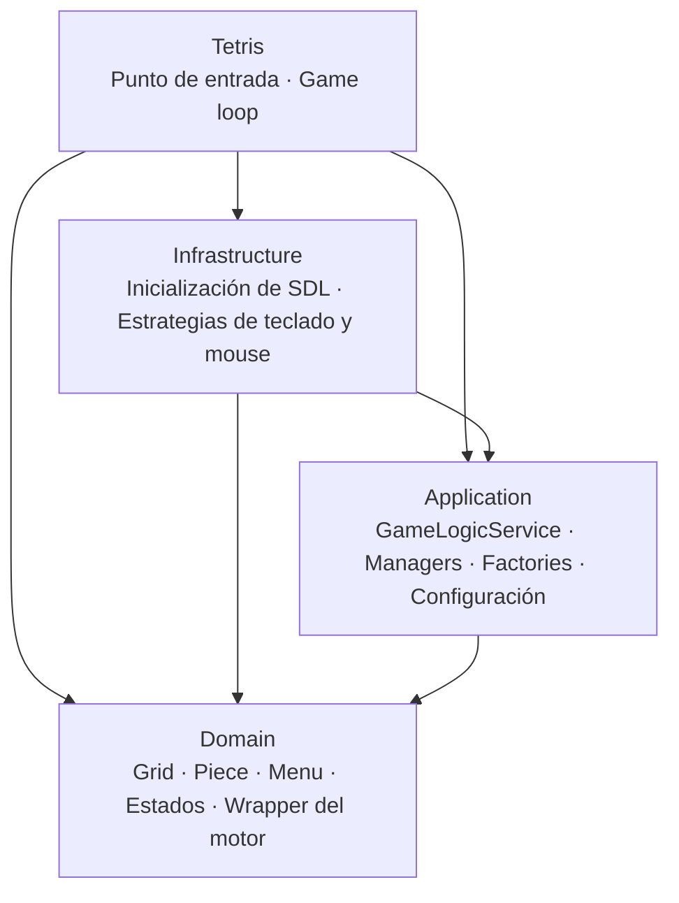

[English](README.md) · **Español**

# 🧱 Tetris (SDL + C#)


**El clásico Tetris, hecho desde cero en C# sobre SDL, siguiendo Clean Architecture y patrones de diseño clásicos.**

<!-- TODO: reemplazar por un GIF real de gameplay -->


---

## Sobre el juego

Un Tetris hecho sin motor de juego: el render, el input, el sonido y el game loop corren directamente sobre SDL a través del wrapper Tao.Sdl. El objetivo fue practicar arquitectura de software en un juego: separar las reglas de la infraestructura y aplicar patrones de diseño donde resuelven un problema real.

## Características

- Mover, rotar, acelerar la caída y guardar piezas, con vista previa de la siguiente pieza.
- Puntaje según las filas completadas a la vez: 100, 300, 500 u 800 puntos para 1 a 4 filas.
- Game Over cuando una pieza nueva no tiene lugar.
- Pantalla de victoria al llegar a **999.999 puntos**, un guiño al tope del contador del Tetris clásico de NES.
- Menús principal, de controles y de créditos, seleccionables con el mouse.
- Música para el menú, la partida, el Game Over y la victoria.

## Controles

| Acción                 | Input          |
| ---------------------- | -------------- |
| Rotar                  | `R`            |
| Mover a la izquierda   | `A`            |
| Mover a la derecha     | `D`            |
| Acelerar la caída      | `S`            |
| Guardar pieza          | `Q`            |
| Elegir en los menús    | Clic del mouse (al pasar por encima se resalta la opción) |

## Highlights técnicos

- **Clean Architecture:** las reglas del juego en `Domain`, la lógica en `Application`, el input y la inicialización de SDL en `Infrastructure`.
- **Strategy** para el input: `KeyboardInputStrategy` y `MouseInputStrategy` implementan el mismo contrato y se pueden intercambiar en tiempo de ejecución.
- **Observer** para el estado del juego: `GameManager` notifica a los managers de sonido, render y movimiento, y cada uno reacciona a los cambios por su cuenta.
- **Factory** para la creación: `PieceFactory` y `MenuFactory` encapsulan cómo se construyen las piezas y los menús.
- **Singleton** para los managers y la configuración global, con un único punto de acceso cada uno.

## Arquitectura



| Proyecto         | Responsabilidad                                                            |
| ---------------- | -------------------------------------------------------------------------- |
| `Domain`         | Entidades (tablero, piezas, menús), estados del juego y wrapper de SDL     |
| `Application`    | Lógica del juego, puntaje, managers, factories y configuración global      |
| `Infrastructure` | Inicialización de SDL y estrategias de input de teclado y mouse            |
| `Tetris`         | Punto de entrada que compone las capas y ejecuta el loop                   |

<details>
<summary><b>Diagramas de los patrones de diseño</b></summary>

**Singleton**

<div align="center">

</div>

**Factory**

<div align="center">

</div>

<div align="center">

</div>

**Strategy**

<div align="center">

</div>

**Observer**

<div align="center">

</div>

</details>

<details>
<summary><b>Estructura del proyecto</b></summary>

```text
Tetris/
├── Tetris.sln
├── Program.cs              Punto de entrada
├── Domain/
│   ├── Core/               Wrappers de Engine, Image, Font y Sound sobre SDL
│   ├── Entities/           Grid, Piece, Menu, MenuItem
│   ├── Enums/              Estados del juego y tipos de pieza
│   └── Interfaces/         Contratos de lógica del juego y observador de estado
├── Application/
│   ├── Assets/             Fuentes, imágenes y sonidos
│   ├── Configurations/     GlobalGameConfiguration
│   ├── Factories/          PieceFactory, MenuFactory
│   ├── Managers/           Managers de juego, movimiento, render y sonido
│   ├── Services/           GameLogicService, GameInterfaceService
│   └── Strategies/         Contratos de input e interfaz
└── Infrastructure/
    ├── Initializers/       GameInitializer
    └── Inputs/             Estrategias de input de teclado y mouse
```

</details>

## Cómo ejecutar el proyecto

### Requisitos

- Windows
- Visual Studio o Rider con **.NET Framework 4.7.2**
- **Tao.Sdl** y las bibliotecas de runtime de SDL 1.2

### Ejecutar en local

```bash
git clone https://github.com/EmilianoBazanZapata/Tetris-Sdl-Tao.git
```

1. Abrir `Tetris/Tetris.sln`.
2. Colocar `Tao.Sdl.dll` y las DLL de runtime de SDL en `Tetris/bin/Debug/`, donde el proyecto las referencia.
3. Compilar y ejecutar el proyecto `Tetris`.

<!-- TODO: confirmar qué DLL de SDL hacen falta exactamente (SDL, SDL_image, SDL_ttf, SDL_mixer) y de dónde descargarlas -->

## Créditos

Diseño y desarrollo por Emiliano Bazán-Zapata, como proyecto para la UTN.

| Contenido              | Autor                                   |
| ---------------------- | --------------------------------------- |
| Fuente Press Start 2P  | CodeMan38 (SIL Open Font License)       |
| Música y efectos       | <!-- TODO: fuentes -->                  |

## Licencia

MIT. <!-- TODO: agregar el archivo LICENSE al repositorio -->

---

**Binary Suns Studio** · [Web](https://binarysunsstudio.com.ar) · [itch.io](https://emiliano-bazan-zapata.itch.io) · [LinkedIn](https://www.linkedin.com/in/emiliano-bazán-zapata-18705721a)
