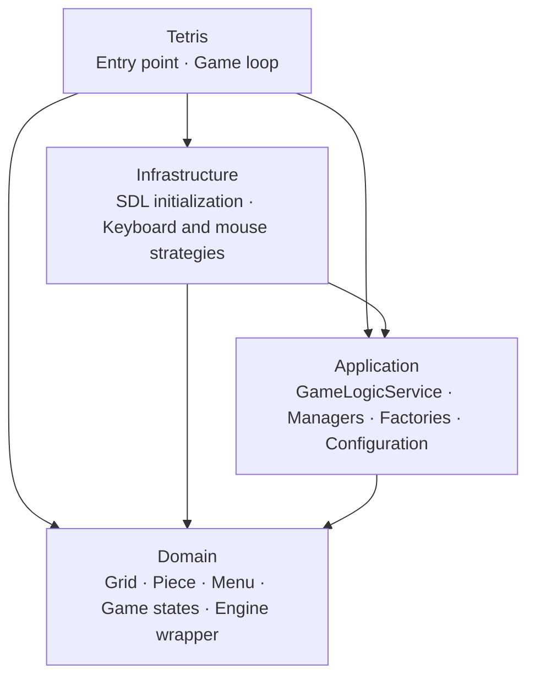

**English** · [Español](README.es.md)

# 🧱 Tetris (SDL + C#)


**The classic Tetris, built from scratch in C# on top of SDL, following Clean Architecture and classic design patterns.**

<!-- TODO: replace with a real gameplay GIF -->


---

## About the game

A Tetris built without a game engine: rendering, input, sound and the game loop run directly on SDL through the Tao.Sdl wrapper. The goal was to practice software architecture in a game: separating the rules from the infrastructure and applying design patterns where they solve a real problem.

## Features

- Move, rotate, soft-drop and hold pieces, with a preview of the next piece.
- Scoring by rows cleared at once: 100, 300, 500 or 800 points for 1 to 4 rows.
- Game Over when a new piece has no room.
- A victory screen at **999,999 points**, a nod to the score counter cap of classic NES Tetris.
- Main, controls and credits menus, selectable with the mouse.
- Music for the menu, the game, Game Over and victory.

## Controls

| Action           | Input          |
| ---------------- | -------------- |
| Rotate           | `R`            |
| Move left        | `A`            |
| Move right       | `D`            |
| Soft drop        | `S`            |
| Hold piece       | `Q`            |
| Select in menus  | Mouse click (hover highlights the option) |

## Technical highlights

- **Clean Architecture:** game rules in `Domain`, game logic in `Application`, SDL input and initialization in `Infrastructure`.
- **Strategy** for input: `KeyboardInputStrategy` and `MouseInputStrategy` implement the same contract and can be swapped at runtime.
- **Observer** for game state: `GameManager` notifies the sound, render and movement managers, so each one reacts to state changes on its own.
- **Factory** for creation: `PieceFactory` and `MenuFactory` encapsulate how pieces and menus are built.
- **Singleton** for the managers and the global configuration, with a single access point each.

## Architecture



| Project          | Responsibility                                                          |
| ---------------- | ----------------------------------------------------------------------- |
| `Domain`         | Entities (grid, pieces, menus), game states and the SDL engine wrapper  |
| `Application`    | Game logic, scoring, managers, factories and global configuration       |
| `Infrastructure` | SDL initialization and the keyboard and mouse input strategies          |
| `Tetris`         | Entry point that composes the layers and runs the loop                  |

<details>
<summary><b>Design pattern diagrams</b></summary>

**Singleton**

<div align="center">

</div>

**Factory**

<div align="center">

</div>

<div align="center">

</div>

**Strategy**

<div align="center">

</div>

**Observer**

<div align="center">

</div>

</details>

<details>
<summary><b>Project structure</b></summary>

```text
Tetris/
├── Tetris.sln
├── Program.cs              Entry point
├── Domain/
│   ├── Core/               Engine, Image, Font and Sound wrappers over SDL
│   ├── Entities/           Grid, Piece, Menu, MenuItem
│   ├── Enums/              Game states and piece types
│   └── Interfaces/         Game logic and state observer contracts
├── Application/
│   ├── Assets/             Fonts, images and sounds
│   ├── Configurations/     GlobalGameConfiguration
│   ├── Factories/          PieceFactory, MenuFactory
│   ├── Managers/           Game, movement, renderer and sound managers
│   ├── Services/           GameLogicService, GameInterfaceService
│   └── Strategies/         Input and interface contracts
└── Infrastructure/
    ├── Initializers/       GameInitializer
    └── Inputs/             Keyboard and mouse input strategies
```

</details>

## Getting started

### Requirements

- Windows
- Visual Studio or Rider with **.NET Framework 4.7.2**
- **Tao.Sdl** and the SDL 1.2 runtime libraries

### Run locally

```bash
git clone https://github.com/EmilianoBazanZapata/Tetris-Sdl-Tao.git
```

1. Open `Tetris/Tetris.sln`.
2. Place `Tao.Sdl.dll` and the SDL runtime DLLs in `Tetris/bin/Debug/`, where the project references them.
3. Build and run the `Tetris` project.

<!-- TODO: confirm the exact SDL runtime DLLs needed (SDL, SDL_image, SDL_ttf, SDL_mixer) and where to get them -->

## Credits

Design and development by Emiliano Bazán-Zapata, as a project for UTN.

| Content               | Author                                   |
| --------------------- | ---------------------------------------- |
| Press Start 2P font   | CodeMan38 (SIL Open Font License)        |
| Music and sound effects | <!-- TODO: sources -->                 |

## License

MIT. <!-- TODO: add the LICENSE file to the repository -->

---

**Binary Suns Studio** · [Website](https://binarysunsstudio.com.ar) · [itch.io](https://emiliano-bazan-zapata.itch.io) · [LinkedIn](https://www.linkedin.com/in/emiliano-bazán-zapata-18705721a)
